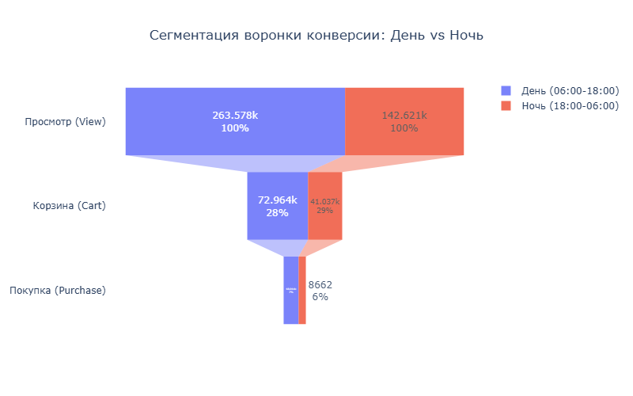
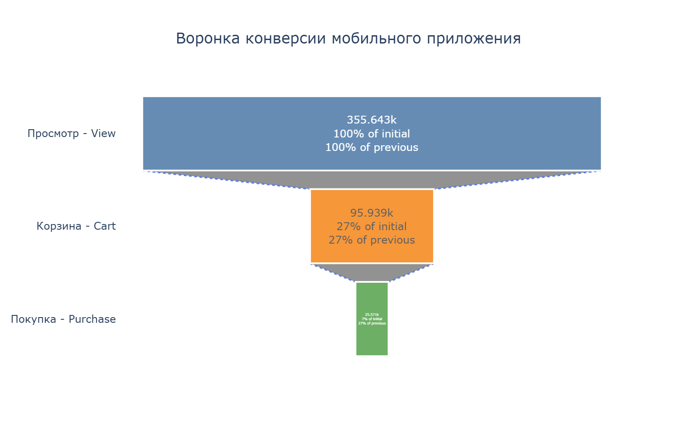

# E-commerce Conversion Funnel Analysis

## Business Objective
The primary goal of this project is to identify bottlenecks in the customer journey of a cosmetics e-commerce mobile application. By analyzing raw clickstream data, the project calculates stage-by-stage conversion rates, identifies the exact steps where users drop off, and formulates data-driven product hypotheses to improve the overall checkout experience.

## Tech Stack

Data manipulation and analysis: Pandas.

Visualization: Interactive funnel charts using plotly.graph_objects.

Environment: Jupyter Notebook, Git.

## Dataset

Source: eCommerce Events History in Cosmetics Shop (Kaggle).
Data Points: Millions of raw event logs containing `event_time`, `event_type`, `product_id`, `user_id`, and `user_session`.

## Methodology

1. Anomaly Detection & Cleaning: Filtered out wholesale bots and scrapers (users with >1000 purchases per day).
2. Funnel Validation: Isolated the core conversion path (`view` -> `cart` -> `purchase`). Cleaned tracking artifacts, strictly removing anomalies where a `purchase` event occurred without a preceding `cart` event for the exact same product within a session.
3. Metric Calculation: Computed Unique Users per stage, Macro-conversion (Overall CR), Micro-conversions (Step-to-step CR), and Median Time-to-Purchase (TTP).
4. Behavioral Segmentation: Split the dataset into "Day" (06:00-18:00) and "Night" (18:00-06:00) cohorts to analyze the impact of time on purchasing intent.

## Product Insights

1. The most critical drop-off occurs at the checkout stage, with 75-79% of users abandoning their carts.
   
Product Hypothesis: This massive drop indicates potential hidden costs at checkout (e.g. unexpected delivery fees), a friction-heavy authorization process, or a behavioral pattern where users treat the cart as a "wishlist" to compare cosmetics before payday.

2. The Day segment generates almost twice as much traffic as the Night segment.
Users add items to the cart at an identical rate regardless of the time of day (28% Day vs. 29% Night).
However, the Day segment converts into actual purchases 16.6% more efficiently than the Night cohort (7% vs. 6% Macro CR).

Product Hypothesis: Nighttime users are prone to window-shopping or are reluctant to manually enter credit card details late at night.

## Recommendations

1. Implement automated morning reminders targeting users who abandoned their carts the previous night.
2. Introduce one-click payment methods (Apple Pay, Google Pay, fast guest checkout) to reduce the mental barrier of nighttime purchases.
3. Display shipping costs and minimum order values directly on the product or cart page to prevent sticker shock at the final checkout step.

Visualization Preview:

